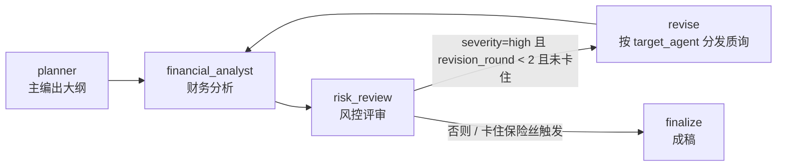

# invest-research-team

投资研究 multi-agent 系统（LangGraph 骨架）：主编出大纲 → 财务分析 → 风控评审 →
（必要时返工）、否则直接成稿。

## 快速开始

```powershell
# 1) 建虚拟环境（Python >= 3.11）
python -m venv .venv
.venv\Scripts\python.exe -m pip install -e ".[dev,data]"

# 2) 配置密钥：复制模板后填入自己的 key
Copy-Item .env.example .env
# 编辑 .env，把 your-api-key-here 换成真实 key

# 3) 跑测试
.venv\Scripts\python.exe -m pytest -q
```

> 注意：venv 的 `Scripts` 目录默认不在 PATH 上，所以用 `python -m pytest`
> 而不是直接敲 `pytest`。

## 环境变量

| 变量 | 必填 | 说明 |
| --- | --- | --- |
| `DEEPSEEK_API_KEY` | 是（真实调用时） | DeepSeek 密钥，只写在 `.env` 里；`.env` 已在 `.gitignore` 中 |
| `DEEPSEEK_BASE_URL` | 否 | 默认 `https://api.deepseek.com` |
| `DEEPSEEK_MODEL` | 否 | 默认 `deepseek-chat` |

优先级：**进程环境变量 > `.env` 文件**（`load_dotenv()` 不覆盖已有变量）。
密钥缺失时 `DeepSeekClient()` 立刻抛 `RuntimeError`，不会用占位 key 去发请求。

## 架构



| 模块 | 职责 |
| --- | --- |
| `src/graph/state.py` | `ResearchState`（TypedDict）+ 字段契约（含 `pending_challenges`、`planner_error`/`analyst_error`/`risk_error`） |
| `src/graph/nodes.py` | 各节点工厂：`make_planner_node(llm)`、`make_financial_analyst_node(llm, data_provider)`、`make_risk_review_node(llm)`、`revise_node` 等 |
| `src/graph/builder.py` | `build_graph(planner_llm=None, financial_llm=None, risk_llm=None, data_provider=None)` 组装图 + 条件路由 |
| `src/llm/client.py` | `DeepSeekClient`：只管发请求拿原始 JSON 字符串，不解析 |
| `src/llm/schemas.py` | Pydantic 输出契约：`OutlineModel`、`FinancialAnalysisModel`、`RiskReviewModel` |
| `src/llm/errors.py` | `LLMTransientError`（可重试）/ `LLMFatalError`（不可重试） |
| `src/tools/financial_data.py` | `AkshareProvider`（真实）+ `FakeProvider`（测试用） |
| `scripts/smoke_risk.py` | 真实链路冒烟：planner + 财务 + 风控，打印 severity / challenges / 走了几轮返工 |
| `scripts/smoke_revision_loop.py` | 真实链路冒烟：观察返工环在真实数据下是否被触发 |
| `scripts/smoke_constructed_revision.py` | 构造式冒烟：首轮注入 flawed 分析，验证 high → 修订 → severity 下降 |

### 节点流

1. **planner**：把标的大纲拆成 4-6 个章节，每章 2-4 个可查证的研究问题。
2. **financial_analyst**：提取股票代码 → 取结构化财务指标 → LLM 出结论。
   只依据给定指标下结论，禁止编造缺失数据（缺失项写进 `assumptions` / `concerns`）。
   若 `pending_challenges` 里有发给自己的质询（由 revise 分发），必须逐条正面回应，
   并在产出里标记 `revised_in_round`；成功后把该 Agent 那一格的待办清空。
3. **risk_review**：以「反方辩手」身份审查前两者的输出，产出
   `severity` + `challenges` + `summary`。审查清单五条：数据质疑 / 逻辑漏洞 /
   反例寻找 / 假设压力测试 / 确认偏误。`severity=high` 触发返工，最多 2 轮。
   - 打分标准：`high`=数据错误或口径错误、或已覆盖维度里的重大逻辑漏洞，应返工；
     `medium`=假设偏激进但可接受，报告披露即可；`low`=常规提示，并入风险章节。
   - 分析师返回 `unavailable` / 报错时，风控必须把这件事实列为 challenge 或在
     summary 里点名——「这份分析没有数据支撑」本身就是最重要的风险。
   - prompt 顶部有**时间锚点**（当前系统日期 + 「报告期晚于知识截止是正常情况，
     属于真实数据」），并有**任务边界**说明：其它板块暂无数据源是已知边界，
     不应仅因覆盖不足就判 high。
4. **revise**：把风控质询按 `target_agent` 分发进分析师的待办箱
   （`pending_challenges`），未知 target 归入 `unassigned` 而不是丢弃；
   同时推进 `revision_round`。
5. **finalize**：成稿（仍是占位，`final_report = "stub report"`）。

### 返工回环与保险丝

`route_after_review` 的判定顺序：

1. `severity != "high"` → 直接成稿；
2. `severity == "high"` 但 `revision_round >= 2` → 停止返工，成稿（轮次上限）；
3. `severity == "high"` 但连续两轮评审都没推进轮次（`stuck`）→ 停止返工，成稿；
4. 否则进入 **revise**：把质询按 `target_agent` 分发到 `pending_challenges`，
   然后回到 **financial_analyst** 带着质询重跑 → 再次风控复审，批判循环闭环
   （`risk_review --revise--> revise -> financial_analyst -> risk_review`）。

第 3 条是保险丝：只靠轮次兜底时，一旦将来调大上限或忘记推进轮次，图会一路撞到
LangGraph 的 `recursion_limit` 抛异常；保险丝保证这种情况退化成「带缺陷成稿」。

### 错误分类与降级

| 情况 | 分类 | 行为 |
| --- | --- | --- |
| JSON 解析失败 / Pydantic 校验失败 / 空响应 | 可重试 | 重试，共 2 次尝试 |
| 限流（429）、网络超时、连接失败 | 可重试 | 重试，共 2 次尝试 |
| 服务端 5xx（500/502/503/504，含 `InternalServerError`） | 可重试 | 重试，共 2 次尝试 |
| 鉴权失败（401/403） | 不可重试 | **立刻**降级，不浪费重试 |
| 其它 4xx（请求本身有问题） | 不可重试 | 立刻降级 |
| 意外异常 | 不可重试 | 立刻降级 |
| 数据源（akshare）抛异常 | 数据源故障 | 不调用 LLM，直接降级，绝不编造数据 |

降级不会中断整条流水线，而是把状态标记出来让下游知道「这块没拿到」：

- planner 失败 → `outline = {"status": "stub", "error": ..., "error_kind": ...}`；
- 财务分析失败 → `analyses.financial_analyst = {"status": "unavailable", ...}`；
- 风控失败 → `severity = "low"` + 空 `challenges`（风控挂了不该卡死报告，
  流程照常走到 finalize）；错误写进 `risk_review.error` / `error_kind` 与顶层 `risk_error`。

三者都会同时在 state 顶层写入 `planner_error` / `analyst_error` / `risk_error` 作为错误摘要。

> 异常判定顺序是 **鉴权 > 限流 > 网络 > status_code 兜底**。本地内省 openai 3.31.0
> 确认 `RateLimitError -> APIStatusError`（`status_code=429`），所以限流必须排在按
> `status_code` 分类之前，否则 429 会落进「其它 4xx → 不可重试」的兜底里被误判成硬故障。
> `APITimeoutError` 归可重试：读超时多为服务端排队或网络抖动，不是配置错误。

## 测试

```powershell
.venv\Scripts\python.exe -m pytest -q
```

当前共 **53** 个测试，全部通过。

测试全部用 `FakeLLM` / `FakeProvider`，**不联网、不 import akshare**；
`tests/conftest.py` 会清空 `DEEPSEEK_API_KEY` 并把 `load_dotenv` 变成 no-op，
避免 `.env` 里的真实 key 漏进测试环境。

| 文件 | 覆盖 |
| --- | --- |
| `tests/test_graph_smoke.py` | 图能跑通、state 字段契约 |
| `tests/test_routing.py` | 条件路由、返工上限、卡住保险丝 |
| `tests/test_planner.py` | planner 正常 / 重试 / 降级 / 401 不重试、缺 key 报错 |
| `tests/test_financial.py` | 财务 Agent 正常 / 重试 / 降级 / 数据源故障不调 LLM |
| `tests/test_financial_data.py` | 数据层：NaN 与前导期清洗、取最新报告期、报告期解析、缺指标报错（假 akshare） |
| `tests/test_risk.py` | 风控 low 放行 / high 触发返工到上限 / 重试 / 降级不卡死 / 看得到 unavailable |
| `tests/test_revise_loop.py` | revise 按 target_agent 分发、分析师消费质询、返工环闭环 |
| `tests/test_error_mapping.py` | openai 异常归类：500 / 503 / 401 / 超时 / 429 |

### 真实链路冒烟（联网，消耗 token）

```powershell
.venv\Scripts\python.exe scripts\smoke_risk.py
```

planner + financial_analyst + risk_review 全用真实 DeepSeek，财务数据取真实 akshare
（标的 300750），打印风控的 severity / challenges / summary 以及整图最终走了几轮返工。
脚本会断言结果中不含 key 明文。

> 注意：模型的知识截止时间可能早于当前系统日期，因此它会把「最新报告期」判为
> 未来数据并据此质疑数据来源——这类质询是**风控在正常工作**（它不盲信数字），
> 但要在解读冒烟结果时区分「真缺陷」与「模型知识过期导致的误判」
> （风控 prompt 已加时间锚点，覆盖缺口已降为 medium）。

构造式返工冒烟（验证批判循环闭环）：

```powershell
.venv\Scripts\python.exe scripts/smoke_constructed_revision.py
```

首轮给分析师注入一份 flawed 财务分析（口径误述 + 自相矛盾的 ROE），其后全部真实 LLM，
用来验证「首轮 high → revise 分发质询 → 分析师真实修订 → 复审降级为 medium/low」成立。

## 目录

```
invest-research-team/
├── .env.example          # 环境变量模板（真实 .env 不入库）
├── pyproject.toml        # 依赖 + pytest 配置
├── src/
│   ├── graph/
│   │   ├── state.py
│   │   ├── nodes.py
│   │   └── builder.py
│   ├── llm/
│   │   ├── client.py
│   │   ├── schemas.py
│   │   └── errors.py
│   └── tools/
│       └── financial_data.py
├── scripts/              # 真实链路冒烟脚本（联网）
│   ├── smoke_risk.py
│   ├── smoke_revision_loop.py
│   └── smoke_constructed_revision.py
├── logs/                 # 逐日进度日志
└── tests/
```
