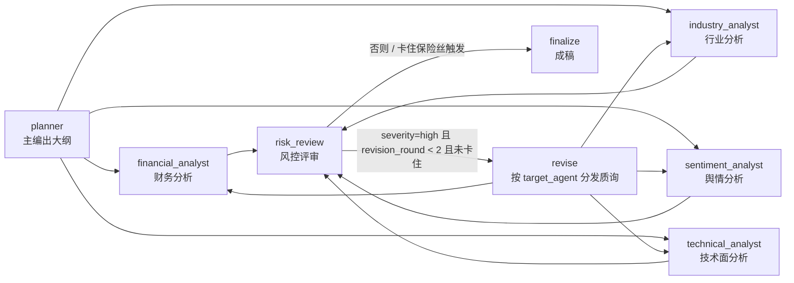

# invest-research-team

投资研究 multi-agent 系统（LangGraph 骨架）：主编出大纲 → 四个分析师并行
（财务 / 行业 / 舆情 / 技术面）→ 风控评审 →（必要时按 `target_agent` 分发质询返工）、
否则直接成稿。

## 快速开始

```powershell
# 1) 建虚拟环境（Python >= 3.11）
python -m venv .venv
.venv\Scripts\python.exe -m pip install -e ".[dev,data]"

# 2) 配置密钥：复制模板后填入自己的 key
Copy-Item .env.example .env
# 编辑 .env，把 your-api-key-here 换成真实 key

# 3) 跑测试
.venv\Scripts\python.exe -m pytest -q
```

> 注意：venv 的 `Scripts` 目录默认不在 PATH 上，所以用 `python -m pytest`
> 而不是直接敲 `pytest`。

## 环境变量

| 变量 | 必填 | 说明 |
| --- | --- | --- |
| `DEEPSEEK_API_KEY` | 是（真实调用时） | DeepSeek 密钥，只写在 `.env` 里；`.env` 已在 `.gitignore` 中 |
| `DEEPSEEK_BASE_URL` | 否 | 默认 `https://api.deepseek.com` |
| `DEEPSEEK_MODEL` | 否 | 默认 `deepseek-chat` |
| `IR_SKIP_CA_BOOTSTRAP` | 否 | 设 `1` 跳过 CA 引导（单元测试用） |
| `IR_ASCII_CA_DIR` | 否 | 指定 CA 副本存放目录（默认取 `<certifi 所在盘根>\irt_ca`） |

优先级：**进程环境变量 > `.env` 文件**（`load_dotenv()` 不覆盖已有变量）。
密钥缺失时 `DeepSeekClient()` 立刻抛 `RuntimeError`，不会用占位 key 去发请求。

## 架构



| 模块 | 职责 |
| --- | --- |
| `src/graph/state.py` | `ResearchState`（TypedDict）+ 字段契约：`analyses` / `pending_challenges` / `analyst_errors` 都是 `Annotated[dict, operator.or_]`（并行节点同时写也不冲突），另有 `planner_error`/`analyst_error`/`risk_error` |
| `src/graph/nodes.py` | 节点工厂：`make_planner_node(llm)`、`make_financial_analyst_node(llm, data_provider)`、`make_industry_analyst_node` / `make_sentiment_analyst_node` / `make_technical_analyst_node`、`make_risk_review_node(llm)`、`revise_node` |
| `src/graph/builder.py` | `build_graph(planner_llm, financial_llm, industry_llm, sentiment_llm, technical_llm, risk_llm, financial_provider, industry_provider, sentiment_provider, technical_provider, data_provider=None)`：planner → 四分析师 fan-out → risk_review → 条件路由；未注入依赖的分析师节点整节点 skip |
| `src/llm/client.py` | `DeepSeekClient`：只管发请求拿原始 JSON 字符串，不解析；异常分类见下 |
| `src/llm/schemas.py` | Pydantic 输出契约：`OutlineModel`、`AnalysisBase`（`conclusion`/`confidence`/`key_points`/`concerns`/`assumptions`）+ `FinancialAnalysisModel` / `IndustryAnalysisModel` / `SentimentAnalysisModel` / `TechnicalAnalysisModel`、`RiskReviewModel`（`Challenge`） |
| `src/llm/errors.py` | `LLMTransientError`（可重试）/ `LLMFatalError`（不可重试） |
| `src/tools/utils.py` | 数据层公共机制：`clean_value`、`period_key`、`pick_latest_row`、`clean_metrics`、`normalize_ticker`、`call_with_timeout`（硬超时）、`fetch_with_retry`（重试 + 退避）、`ensure_ascii_ca`（中文路径 CA 引导） |
| `src/tools/financial_data.py` | `AkshareProvider`（真实）+ `FakeProvider`（测试用）：最新期指标 + 杜邦上下文（权益乘数 / 恒等式自检）+ 口径标注 + 近 5 期趋势 |
| `src/tools/industry_data.py` | `AkshareIndustryProvider`（真实）+ `FakeIndustryProvider`：所属板块（datacenter 行业层级 → 同花顺板块行情）+ 同业 2-3 家 PE/PB |
| `src/tools/sentiment_data.py` | `AkshareSentimentProvider`（真实）+ `FakeSentimentProvider`：最近 10 条新闻（标题/摘要截断/发布时间，自行按时间倒序） |
| `src/tools/technical_data.py` | `AkshareTechnicalProvider`（真实）+ `FakeTechnicalProvider`：近 120 交易日算 MA5/20/60、近 20 日涨跌幅、区间高低点、量比；**双源容灾**（新浪主源 + 东财自动 fallback） |
| `scripts/smoke_multi_agent.py` | 两阶段真实冒烟：阶段一四源取数（不调 LLM，写快照），阶段二全图带真实 key 跑（读快照，不碰 akshare） |

### 节点流

1. **planner**：把标的大纲拆成 4-6 个章节，每章 2-4 个可查证的研究问题。
2. **四个分析师并行**（planner 之后同一批 fan-out，全部汇入 risk_review）：
   - `financial_analyst`：财务指标（roe / 净利率 / 负债率 / 营收增速 …）；
   - `industry_analyst`：所属行业板块、板块近期表现、同业估值对比；
   - `sentiment_analyst`：最近 10 条新闻（标题 + 摘要 + 发布时间）；
   - `technical_analyst`：MA5/20/60、近 20 日涨跌幅、区间高低点、量比。
   四者共用同一套模板：只依据给定数据下结论、`key_points` 标注 `data_source`、
   缺失数据写进 `concerns`/`assumptions` 且禁止编造；有发给自己的质询时必须逐条
   正面回应并标记 `revised_in_round`，成功后只清空自己那一格 `pending_challenges`。
   - **幂等跳过**：若自己既无待办、`analyses` 里又已有结果 → 直接返回空 dict、
     不调 LLM。这样返工轮可以无脑 fan-out 到四个分析师，本轮无事的自动空转。
3. **risk_review**：以「反方辩手」身份审查四份分析，产出 `severity` + `challenges`
   + `summary`。审查清单五条：数据质疑 / 逻辑漏洞 / 反例寻找 / 假设压力测试 /
   确认偏误。`severity=high` 触发返工，最多 2 轮。
   - 打分标准：`high`=数据错误或口径错误、或已覆盖维度里的重大逻辑漏洞，应返工；
     `medium`=假设偏激进但可接受，报告披露即可；`low`=常规提示，并入风险章节。
   - 分析师返回 `unavailable` / 报错时，风控必须把这件事实列为 challenge 或在
     summary 里点名——「这份分析没有数据支撑」本身就是最重要的风险。
   - prompt 顶部有**时间锚点**（当前系统日期 + 「报告期晚于知识截止是正常情况，
     属于真实数据」），并有**任务边界**说明：当前分析师为四个，
     估值 / 宏观 / 政策等维度暂无数据源是已知边界，不应仅因覆盖不足就判 high。
   - 四份分析序列化超过 6000 字符时只保留 `conclusion`/`confidence`/`status` 与
     每条分析前 4 个 `key_points`，防止 prompt 被撑爆。
4. **revise**：把风控质询按 `target_agent` 分发进分析师的待办箱
   （`pending_challenges`），未知 target 归入 `unassigned` 而不是丢弃；
   同时推进 `revision_round`，然后回到四个分析师。
5. **finalize**：成稿（仍是占位，`final_report = "stub report"`）。

### 返工回环与保险丝

`route_after_review` 的判定顺序：

1. `severity != "high"` → 直接成稿；
2. `severity == "high"` 但 `revision_round >= 2` → 停止返工，成稿（轮次上限）；
3. `severity == "high"` 但连续两轮评审都没推进轮次（`stuck`）→ 停止返工，成稿；
4. 否则进入 **revise**：把质询按 `target_agent` 分发到 `pending_challenges`，
   然后回到四个分析师（无事者幂等跳过）→ 再次风控复审，批判循环闭环
   （`risk_review --revise--> revise -> 四分析师 -> risk_review`）。

第 3 条是保险丝：只靠轮次兜底时，一旦将来调大上限或忘记推进轮次，图会一路撞到
LangGraph 的 `recursion_limit` 抛异常；保险丝保证这种情况退化成「带缺陷成稿」。

### 错误分类与降级

| 情况 | 分类 | 行为 |
| --- | --- | --- |
| JSON 解析失败 / Pydantic 校验失败 / 空响应 | 可重试 | 重试，共 2 次尝试 |
| 限流（429）、网络超时、连接失败 | 可重试 | 重试，共 2 次尝试 |
| 服务端 5xx（500/502/503/504，含 `InternalServerError`） | 可重试 | 重试，共 2 次尝试 |
| 鉴权失败（401/403） | 不可重试 | **立刻**降级，不浪费重试 |
| 其它 4xx（请求本身有问题） | 不可重试 | 立刻降级 |
| 意外异常 | 不可重试 | 立刻降级 |
| 数据源（akshare）抛异常 | 数据源故障 | 不调用 LLM，直接降级，绝不编造数据 |
| 数据源调用超过 20s | 数据源故障 | 硬超时（线程兜底）→ 同一个降级路径 |

降级不会中断整条流水线，而是把状态标记出来让下游知道「这块没拿到」：

- planner 失败 → `outline = {"status": "stub", "error": ..., "error_kind": ...}`；
- 任一分析师失败 → `analyses.<agent> = {"status": "unavailable", ...}` +
  `analyst_errors.<agent>`；
- 风控失败 → `severity = "low"` + 空 `challenges`（风控挂了不该卡死报告，
  流程照常走到 finalize）；错误写进 `risk_review.error` / `error_kind` 与顶层 `risk_error`。

> 异常判定顺序是 **鉴权 > 限流 > 网络 > status_code 兜底**。本地内省 openai 3.31.0
> 确认 `RateLimitError -> APIStatusError`（`status_code=429`），所以限流必须排在按
> `status_code` 分类之前，否则 429 会落进「其它 4xx → 不可重试」的兜底里被误判成硬故障。
> `APITimeoutError` 归可重试：读超时多为服务端排队或网络抖动，不是配置错误。

### 数据源注意事项（真实联网时）

- **硬超时**：akshare 多数接口不接受 `timeout` 参数（`stock_zh_a_hist` 默认 `None`），
  网络半死会无限期挂住。所有真实调用都经 `call_with_timeout` 走 daemon 线程，
  默认 20 秒（`utils.DEFAULT_TIMEOUT`），超时抛 `TimeoutError` → 节点按数据源故障降级。
- **重试与退避**：普通源固定间隔重试；技术面日线（push2his）实测会**突发限流**
  ——同一 300 日窗口第 1、2 次成功，第 3 次起连小窗口也 `RemoteDisconnected`，
  隔约 1 分钟新进程首次调用即恢复。故日线用 1.5/3/6/12 秒递增退避（5 次尝试，
  总耐心约 23 秒），兜不住就走 unavailable 降级并如实标注。
- **技术面双源容灾**：主源 `ak.stock_zh_a_daily`（新浪，qfq；symbol 必须带 `sz`/`sh` 前缀，
  列名是英文 `date/open/high/low/close/volume/...`，实测 300750 取 187 行只要 ~2s），
  东财 `stock_zh_a_hist` 降为**自动 fallback**：主源任一环节失败（重试耗尽 / 超时 / 列不符）
  就切 fallback，**两源各自**套用同一 20s 超时与同一退避序列（最坏 23s + 23s），
  两源都失败才降级 unavailable。输出用 `source` / `fallback_used` / `primary_error` 标注实际口径；
  两源复权因子有细微差异，对 MA / 涨跌幅 / 量比这类相对指标可接受，**不做交叉校正**。
- **财务口径**：同一张接口表里混着不同口径族——`总资产利润率(%)` 是**利润总额**口径、
  `总资产净利润率(%)` 是**净利润**口径；`净资产收益率(%)` 是**摊薄**、`加权净资产收益率(%)` 是加权；
  现金流量表口径按**全部权益**、资产负债表口径按**归母**（两者相差约 7%）；半年报指标**未年化**。
  财务输出因此显式给出 `period_scale`（期间尺度）、`dupont`（权益乘数、`roe_implied_roa_x_em`、
  `identity_gap_pct` 恒等式自检）、`trend`（近 5 期趋势）、`caliber_notes`（口径标注）；
  风控 prompt 要求**先按恒等式验算再质疑口径**，验算通过不得再以口径矛盾质询。
- **Windows 中文路径 CA 坑**：`curl_cffi` 底层 libcurl 无法从含中文的路径加载
  CAfile，报 `SSLError: curl: (77) error adding trust anchors from locations:
  CAfile: ...`——同一份 `cacert.pem` 放到 ASCII 路径后立刻恢复正常。`utils.ensure_ascii_ca()`
  在模块导入时把 certifi 的 CA 复制到 ASCII 目录（默认 `<盘根>\irt_ca\cacert.pem`）
  并设置 `CURL_CA_BUNDLE` / `REQUESTS_CA_BUNDLE` / `SSL_CERT_FILE`；路径本身已是
  ASCII 或设了 `IR_SKIP_CA_BOOTSTRAP=1` 时什么都不做。

## 测试

```powershell
.venv\Scripts\python.exe -m pytest -q
```

当前共 **126** 个测试，全部通过。

测试全部用 `FakeLLM` / `FakeProvider` / 假 akshare 模块，**不联网、不 import akshare**；
`tests/conftest.py` 会清空 `DEEPSEEK_API_KEY`、把 `load_dotenv` 变成 no-op，
并设 `IR_SKIP_CA_BOOTSTRAP=1`（避免测试在仓库外写 CA 副本）。

| 文件 | 覆盖 |
| --- | --- |
| `tests/test_graph_smoke.py` | 图能跑通、state 字段契约 |
| `tests/test_routing.py` | 条件路由、返工上限、卡住保险丝 |
| `tests/test_planner.py` | planner 正常 / 重试 / 降级 / 401 不重试、缺 key 报错 |
| `tests/test_financial.py` | 财务 Agent 正常 / 重试 / 降级 / 数据源故障不调 LLM |
| `tests/test_financial_data.py` | 财务数据层：NaN 与前导期清洗、取最新报告期、缺指标报错、期间尺度、杜邦上下文与恒等式自检、口径标注、近 5 期趋势 |
| `tests/test_risk.py` | 风控 low 放行 / high 触发返工到上限 / 重试 / 降级不卡死 / 看得到 unavailable / prompt 含验算义务 |
| `tests/test_revise_loop.py` | revise 按 target_agent 分发、分析师消费质询、返工环闭环 |
| `tests/test_error_mapping.py` | openai 异常归类：500 / 503 / 401 / 超时 / 429 |
| `tests/test_multi_agent.py` | 三个新 Agent 的 valid / transient / fatal / provider 故障 / 消费质询、幂等跳过、四分析师并行、定向返工、severity 下降 |
| `tests/test_data_providers.py` | 行业 / 舆情 / 技术面清洗口径 + 硬超时降级 + 日线退避序列 + CA 引导 + 日线双源（主源优先 / 切 fallback / 双源皆败降级） |

### 真实链路冒烟（联网，消耗 token）

```powershell
# 多分析师两阶段冒烟（推荐写成日志文件：分钟级真实调用，日志能留下完整过程）
.venv\Scripts\python.exe -u -X utf8 scripts\smoke_multi_agent.py --stage 1 > _smoke7_stage1.log 2>&1
.venv\Scripts\python.exe -u -X utf8 scripts\smoke_multi_agent.py --stage 2 > _smoke7_stage2.log 2>&1
```

- **阶段一**：四个 Provider 分别真实取 300750（`--stage 1`，不调 LLM），逐个打印
  耗时与可人工核对的摘要，并把结果写成 `_smoke7_snapshot.json`；单个源失败只记录、
  不阻塞其余三个。
- **阶段二**：`--stage 2` 读快照跑全图（阶段二不碰 akshare），打印每轮 severity、
  质询的 `target_agent` 分布、四个分析师的 `conclusion`/`confidence`、返工轮次与最终路径。
  指定 `--stage all` 可在同一进程里先 1 后 2。
- 每行输出带 `[HH:MM:SS +Ns]` 时间戳，结束标记是 `SMOKE STAGE1 DONE` /
  `SMOKE STAGE2 DONE`（看到标记才说明整段跑完）；输出出现 key 明文即 exit 2。

其余单链路冒烟：

```powershell
.venv\Scripts\python.exe scripts\smoke_risk.py
.venv\Scripts\python.exe scripts\smoke_constructed_revision.py
```

`smoke_risk.py` 跑 planner + 财务 + 风控；`smoke_constructed_revision.py` 首轮注入
flawed 分析（口径误述 + 自相矛盾的 ROE），验证「首轮 high → revise 分发质询 →
分析师真实修订 → 复审降级」成立。

> 注意：模型的知识截止时间可能早于当前系统日期，因此它会把「最新报告期」判为
> 未来数据并据此质疑数据来源——这类质询是**风控在正常工作**（它不盲信数字），
> 但要在解读冒烟结果时区分「真缺陷」与「模型知识过期导致的误判」
> （风控 prompt 已加时间锚点，覆盖缺口已降为 medium）。

## 目录

```
invest-research-team/
├── .env.example          # 环境变量模板（真实 .env 不入库）
├── pyproject.toml        # 依赖 + pytest 配置
├── src/
│   ├── graph/
│   │   ├── state.py
│   │   ├── nodes.py
│   │   └── builder.py
│   ├── llm/
│   │   ├── client.py
│   │   ├── schemas.py
│   │   └── errors.py
│   └── tools/
│       ├── utils.py             # 清洗 + 超时 + 重试退避 + CA 引导
│       ├── financial_data.py
│       ├── industry_data.py
│       ├── sentiment_data.py
│       └── technical_data.py
├── scripts/              # 真实链路冒烟脚本（联网）
│   ├── smoke_multi_agent.py
│   ├── smoke_risk.py
│   ├── smoke_revision_loop.py
│   └── smoke_constructed_revision.py
├── logs/                 # 逐日进度日志
└── tests/
    ├── test_graph_smoke.py
    ├── test_routing.py
    ├── test_planner.py
    ├── test_financial.py
    ├── test_financial_data.py
    ├── test_risk.py
    ├── test_revise_loop.py
    ├── test_error_mapping.py
    ├── test_multi_agent.py
    └── test_data_providers.py
```
